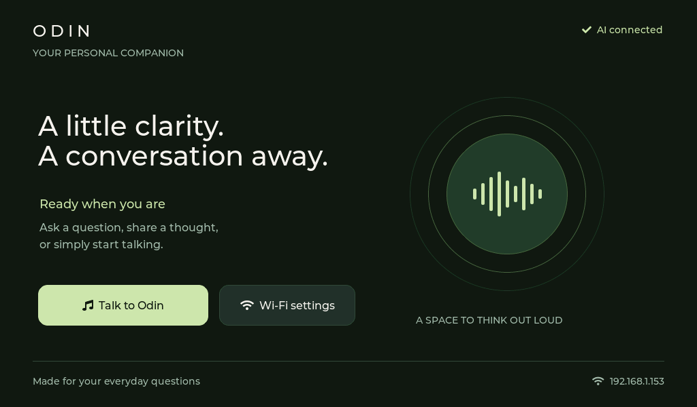
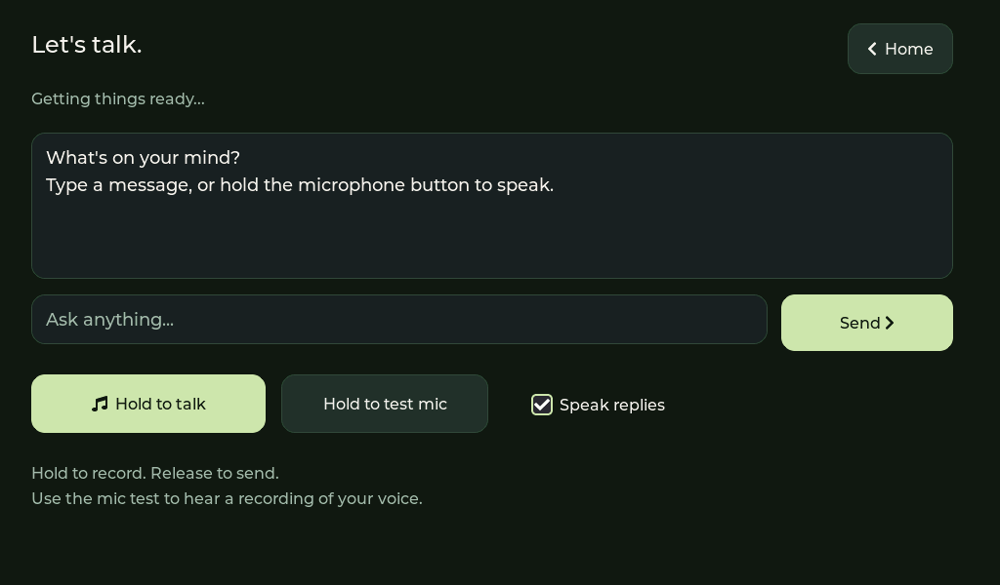

# Odin2

A local voice assistant for the Elecrow CrowPanel Advanced 10.1-inch V1.0
(ESP32-P4 with ESP32-C6 Wi-Fi).

## Features

- Charcoal-and-sage touch interface with chat and floating Wi-Fi keyboard.
- Wi-Fi scanning, automatic credential saving after connection, and Forget network.
- LM Studio text chat, push-to-talk microphone input, and spoken replies.
- Local faster-whisper recognition and Piper Ryan high-quality neural speech.
- Standalone microphone recording/playback test.

## Setup

Firmware build and flashing: [firmware/README.md](firmware/README.md).
Voice-server installation and startup: [ai-server/VOICE.md](ai-server/VOICE.md).
Source package notes: [START_HERE.md](START_HERE.md).

The firmware targets ESP-IDF 5.5 and includes its component source dependencies.
Use `ODIN_IDF_PATH` to select your installed ESP-IDF directory. No initial Wi-Fi
password is included or required: connect through the panel's Wi-Fi settings.
For optional initial provisioning, copy `wifi_defaults.example.h` to
`wifi_defaults.local.h` in `firmware/components/odin_wifi/`; the local header is
ignored by git. Never commit credentials or firmware binaries containing them.

LM Studio and voice-server LAN addresses are configured in
`firmware/main/odin_ai.c` and `firmware/main/odin_voice.h`. Adjust them for your
network. Download Piper weights as described in the voice setup; installed
Python environments, model weights, and firmware build products are excluded.

## Interface previews

These are native LVGL host renders, not photographs of the hardware.

## Hardware status

Display, touch, saved Wi-Fi reconnect, audio-driver initialization, and LM Studio
model discovery have been checked on the panel. Server speech synthesis and
recognition round-trip tests passed. Physical microphone/speaker quality and
complete voice interactions depend on the board and local network.

## Licenses

See [LICENSE.txt](LICENSE.txt) and the licenses inside each bundled dependency.
The downloaded Ryan voice has its own model card in `ai-server/voices/`.
